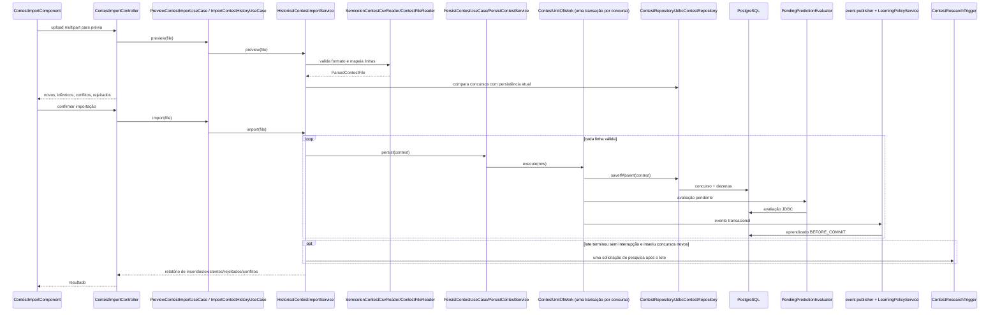
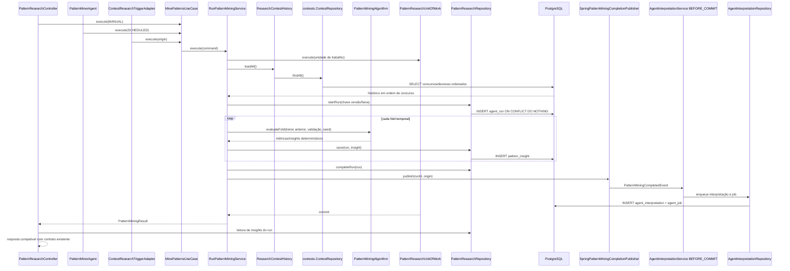

# 04 — Fluxos observados após a Fase 3

## Cadastrar concurso

```mermaid
sequenceDiagram
    participant C as contests.adapter.in.web.ContestController
    participant H as RegisterContestHandler
    participant D as domain.Contest
    participant P as PersistContestUseCase
    participant S as PersistContestService
    participant TX as ContestUnitOfWork/SpringContestUnitOfWork
    participant R as ContestRepository/JdbcContestRepository
    participant DB as PostgreSQL
    participant E as JdbcPendingPredictionEvaluator
    participant PUB as SpringContestResultEventPublisher
    participant L as LearningPolicyService BEFORE_COMMIT
    participant M as ContestResearchTriggerAdapter/MineContestPatternsService

    C->>C: Bean Validation e DTO → RegisterContestCommand
    C->>H: register(command)
    H->>D: cria Contest e valida invariantes
    H->>P: persist(contest)
    P->>S: persist(contest)
    S->>TX: execute(unidade de trabalho)
    TX->>R: saveIfAbsent(contest)
    R->>DB: INSERT parent ON CONFLICT + reconstrução/comparação
    alt concurso novo
        R->>DB: batch INSERT das 15 dezenas
        R-->>TX: criado
        TX->>E: evaluateForContest(number)
        E->>DB: grava avaliações pendentes
        TX->>PUB: publish(ContestResultPersistedEvent)
        PUB->>L: Spring event na transação atual
        L->>DB: atualiza candidato/grava learning_event
        TX-->>S: true, commit
    else mesmo conteúdo já existente
        R-->>TX: idêntico
        TX-->>S: false, sem avaliação nem evento
    else mesmo número e conteúdo diferente
        R-->>TX: ContestConflictException
        TX-->>S: rollback
    end
    S-->>P: criado/idempotente
    P-->>H: resultado
    H->>M: solicita pesquisa síncrona também em retry idempotente
    M->>M: miner idempotente por versão e faixa
    H-->>C: resultado de registro
    C-->>C: 201 novo, 200 idêntico; contratos existentes
```

`PersistContestService` define a ordem da orquestração; `SpringContestUnitOfWork` delimita a transação. `JdbcContestRepository` apenas grava/reconstrói o agregado e suas dezenas. `JdbcPendingPredictionEvaluator` e publisher são portas/adapters separados. O evento é publicado **antes do commit**, porque o listener atual grava aprendizagem no mesmo banco e a exigência é atomicidade: rollback desfaz concurso, dezenas, avaliações e efeitos de aprendizagem. O listener `LearningPolicyService.onRealContestPersisted` é `@TransactionalEventListener(BEFORE_COMMIT)`. Não há necessidade atual de outbox: não existe consumidor externo assíncrono que exija entrega durável independente; se esse requisito surgir, avaliar outbox/job e idempotência em ADR próprio.

Após o caso transacional, `RegisterContestHandler` solicita a pesquisa de padrões. `ContestResearchTriggerAdapter` chama a mineração síncrona e captura falhas, registrando `false`; a persistência já foi confirmada e a resposta HTTP mantém a semântica atual. Um retry manual idêntico solicita a pesquisa novamente. `MineContestPatternsService` usa chave idempotente de versão/faixa, portanto uma execução concluída não é duplicada. Timeout ainda não está configurado; uma operação de mineração lenta pode alongar a resposta.

## Importar histórico CSV



`HistoricalContestImportService` faz leitura/prévia e coordena o lote; `PersistContestUseCase` é a única rota de gravação. Cada concurso tem sua própria transação. Linhas inválidas são reportadas; falha de persistência interrompe o restante e o relatório identifica linhas não processadas, preservando commits anteriores válidos. O miner é chamado uma vez ao final somente se houve novos concursos; concursos antigos idênticos não geram trabalho de mineração. Não há alteração de datas/resultados suspeitos.

## Pesquisador de padrões



`PatternMiningAlgorithm` é cálculo puro, fixado em `walk-forward-2`; não importa Spring, JDBC, HTTP ou logging. `RunPatternMiningService` ordena a série, cria chave `pattern-miner:<algorithmVersion>:<first>:<last>`, delimita treino/validação e coordena as portas. `SpringPatternResearchUnitOfWork` usa `TransactionTemplate`; a publicação do evento ocorre depois de `completeRun` e ainda dentro da transação. O listener `BEFORE_COMMIT` grava interpretação/job na mesma transação. Uma falha nessa gravação reverte run/insights e permite retry; a chave única evita duplicar execuções concorrentes já confirmadas.

O controller mantém `POST /api/agentes/pesquisador/minerar`, `GET /api/agentes/pesquisador/insights` e `GET /api/agentes/pesquisador/interpretacao`, com formato e status preexistentes. O endpoint manual devolve os insights do run recém-executado; uma repetição idempotente devolve zero insights e não enfileira novo job. `PatternMinerAgent` chama o mesmo caso de uso via cron. O trigger usado por cadastro/importação permanece síncrono e captura falhas após o commit do concurso, conforme contrato atual.

## Agente avaliador, Gemini e ML (fora da Fase 3)

`OptimizedGameGeneratorService`, `GameBacktestingService`, persistência de previsões, serviço/worker Gemini e ML permanecem nas camadas anteriores. A extração de pesquisa preserva `PatternInsightRepository` compartilhado para que o avaliador continue consultando evidências por corte temporal, sem migração de seu módulo nesta fase.

Gemini apenas interpreta métricas calculadas/persistidas; não calcula métricas oficiais. Scores retrospectivos não são probabilidades de prêmio nem evidência automática de capacidade preditiva.
