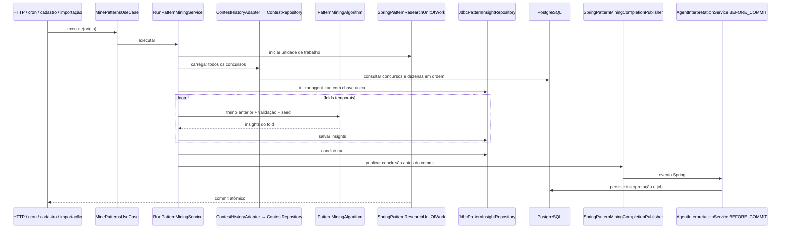

# LotoLab — Relatório da Fase 3: mineração funcional de padrões

**Data:** 12/11/2026
**Escopo:** extrair somente a capacidade de mineração de padrões para `research` em arquitetura hexagonal e demonstrar a execução real sobre PostgreSQL Testcontainers. As outras capacidades não foram refatoradas.

## Resumo

A mineração foi separada do serviço monolítico anterior. O algoritmo estatístico `walk-forward-2` foi preservado, agora sem dependência de Spring, JDBC, HTTP, logging ou adaptadores. Um caso de uso coordena as portas; REST, scheduler e trigger usam esse caso de uso; JDBC, transação e publicação Spring foram isolados como adapters.

O endpoint manual gravou um run, 360 insights em cinco folds, retornou a resposta existente, e os endpoints GET consultaram os registros. A repetição não duplicou dados. Duas chamadas concorrentes produziram um único run. Uma falha deliberada do job fez o run, insights, interpretação e job reverterem juntos. Uma fixture sintética de 3.802 concursos gerou 882 insights em seis folds em **13,681 segundos**.

## Diagnóstico confirmado

Antes da extração, `MineContestPatternsService` acumulava cálculo walk-forward, orquestração, anotações transacionais Spring, publicação de evento, `LogContext` e acesso à persistência. Havia um construtor alternativo com publisher sem efeito. `PatternResearchController` chamava diretamente o serviço de mineração, o repositório de insights e o serviço de interpretação. Cron e cadastro/importação também dependiam da implementação antiga.

O fluxo já usava idempotência por algoritmo e faixa, `agent_run`, persistência de insights versionados, e o listener `AgentInterpretationService.onMiningCompleted` em `BEFORE_COMMIT`. A migração preservou esses comportamentos e os comprovou em teste, em vez de deslocar o evento para depois do commit.

## Arquitetura nova

```text
research/
├── domain/
│   └── PatternMiningAlgorithm
├── application/
│   ├── ResearchJobSummary
│   ├── port/in/ (comando, casos de uso e resultado)
│   ├── port/out/ (histórico, runs/insights, unidade de trabalho, evento e consultas)
│   └── service/ (mineração e consultas)
├── adapter/
│   ├── in/web/ (controller e DTOs das rotas existentes)
│   ├── in/scheduler/ (PatternMinerAgent)
│   └── out/ (concursos, JDBC, transação, evento e consultas de interpretação)
└── bootstrap/
    └── PatternResearchConfiguration
```

Classes relevantes:

- `PatternMiningAlgorithm`: cálculo determinístico puro; preserva métricas, baseline, janelas, seed e identificador `walk-forward-2`.
- `RunPatternMiningService`: ordena concursos, ignora histórico com menos de três concursos, calcula folds, cria chave idempotente, persiste o run e os insights, marca conclusão e solicita publicação do evento.
- Portas de entrada: `MinePatternsUseCase`, consultas de insights/run/interpretação/job; `MinePatternsCommand` valida origem; `PatternMiningResult` comunica situação, intervalo, quantidade e folds.
- Portas de saída: `ResearchContestHistory`, `PatternResearchRepository`, `PatternResearchUnitOfWork`, `PatternMiningCompletionPublisher`, `ResearchInterpretationQueries`.
- Adapters: `ContestHistoryAdapter`; `JdbcPatternInsightRepository`; `SpringPatternResearchUnitOfWork`; `SpringPatternMiningCompletionPublisher`; `ResearchInterpretationQueriesAdapter`.
- Entradas: `PatternResearchController`, `PatternMinerAgent`, e o `ContestResearchTriggerAdapter` da capacidade `contests`, que chama a porta de entrada de pesquisa.
- `PatternResearchConfiguration`: composição explícita dos serviços e portas.
- `AgentInterpretationService` e o record `PatternMiningCompletedEvent` continuam no pacote anterior: são a integração já compartilhada com outros módulos e não foram reorganizados nesta fase.

## Fluxo transacional



O evento é disparado dentro da transação depois da conclusão do run; `AgentInterpretationService` recebe-o em `BEFORE_COMMIT` e chama a persistência com propagação `MANDATORY`. Se o listener/job falha, o rollback remove o run e seus insights e não sobra interpretação/job órfão. Como a chave única também reverte, um retry futuro consegue tentar novamente. Gemini não é chamado nessa operação.

### Cadastro e importação

O cadastro continua persistindo pelo fluxo `contests` e depois pode solicitar pesquisa síncrona via `ContestResearchTriggerAdapter`. O adapter captura `RuntimeException`, registra falha e retorna `false`; a gravação do concurso já confirmada permanece. O retry de cadastro idempotente pode solicitar pesquisa outra vez, sem duplicar run já completado. O importador existente chama o trigger uma vez ao final de lote bem-sucedido com concursos novos, e não por linha nem após lote abortado. Esse fluxo foi preservado, não redesenhado.

## Contratos mantidos

- `POST /api/agentes/pesquisador/minerar`
- `GET /api/agentes/pesquisador/insights`
- `GET /api/agentes/pesquisador/interpretacao`
- O DTO `MiningRunResponse`, campos, status 200 e mensagens de mineração/idempotência não foram alterados.
- Algoritmo `walk-forward-2` e chave `pattern-miner:walk-forward-2:<primeiro>:<último>` preservados.
- Mineração usa treino estritamente anterior ao bloco de validação; a validação não entra no treino do próprio fold. Sementes determinísticas permanecem derivadas da faixa e do número do fold.

## Regras arquiteturais

As **oito regras originais da Fase 2.1 continuam** no `ArchitectureRulesTest`. Foram acrescentadas seis regras para:

1. independência do domínio `research` em relação a frameworks/adapters;
2. aplicação `research` sem framework, controller, infraestrutura, output adapters ou bootstrap;
3. adapters de entrada sem acesso a output ports/implementações JDBC;
4. adapters de saída sem dependência de input ports;
5. bootstrap não referenciado por camadas internas;
6. ausência de ciclos nos slices `research`.

São fronteiras de `contests` e `research`, não uma promessa de que todo o legado agora é hexagonal.

## Evidências PostgreSQL reais (Testcontainers)

Foi usado PostgreSQL `17-alpine` descartável. Flyway validou e aplicou V1–V9 no container; nada foi migrado no banco local.

### Mineração HTTP com fixture de 30 concursos

- `POST /api/agentes/pesquisador/minerar`: HTTP 200, `insightsWritten=360`, `foldCount=5`, um `agent_run` `COMPLETED`, versão `walk-forward-2`.
- Foram gravados 360 registros em `pattern_insight`, cinco inícios de validação distintos e um registro de interpretação mais um job `PENDING`.
- A verificação SQL confirmou zero insights em que `training_last_contest >= validation_first_contest`.
- `GET /api/agentes/pesquisador/insights`: HTTP 200 e 360 itens persistidos.
- `GET /api/agentes/pesquisador/interpretacao`: HTTP 200, run correspondente e status `PENDING`.
- Repetir POST com mesma faixa/versão: HTTP 200, `insightsWritten=0`; permanece um run, 360 insights e um job.

### Concorrência e rollback

- Duas chamadas simultâneas ao caso de uso, mesma faixa: exatamente um resultado `COMPLETED` e um `ALREADY_COMPLETED`; uma única linha `agent_run`, 360 insights, uma interpretação e um job. Os logs registraram `CREATED` e `IDEMPOTENT_SKIP`.
- Uma constraint temporária no banco de teste rejeitou `RESEARCH_INTERPRETATION`; após a falha, as contagens de run de pesquisa, insights, interpretações e jobs ficaram em zero. A constraint foi removida no próprio container em bloco `finally`, e o container é descartável.

### Escala equivalente ao histórico

Fixture sintética e determinística, gerada dentro do container; não é o CSV histórico nem dado oficial. O intervalo foi `80001..83802` (3.802 concursos). Resultado observado: **6 folds, 882 insights, 13,681 s**. A última validação tinha uma observação e produziu 147 registros `INSUFFICIENT_DATA`, sem promover evidência. A medição é específica desta máquina/execução e não é SLA.

### Cálculo unitário numérico

O teste `PatternMiningAlgorithmTest` fixa seis concursos, compara duas execuções com a mesma seed e confirma igualdade dos insights; verifica média de ímpares com erro `1.000000`, taxa prevista/observada da dezena 1, baseline numérica `0.400000`, faixa treino `1..3`, validação `4..4`, 72 métricas esperadas e a versão do algoritmo.

## Arquivos Java do escopo

### Criados ou relocados para `research`

- Domínio: `PatternMiningAlgorithm`.
- Aplicação: portas em `application/port/in` e `application/port/out`, `ResearchJobSummary`, `RunPatternMiningService` e serviços de consulta.
- Entrada: `PatternResearchController`, `PatternInsightResponse`, `AgentInterpretationResponse`, `PatternMinerAgent`.
- Saída/bootstrap: adapters JDBC, concorrência/histórico, transação Spring, evento, consulta de interpretação e `PatternResearchConfiguration`.
- Testes novos: `PatternMiningAlgorithmTest`, `RunPatternMiningServiceTest`, `PatternMiningPostgresIntegrationTests`.

### Modificados ou removidos pela extração

- `ContestResearchTriggerAdapter` agora depende de `MinePatternsUseCase` e mantém o comportamento de captura de falha.
- `AgentInterpretationService` usa a constante de versão de `PatternMiningAlgorithm`.
- `FrequencyAnalysisIntegrationTests` chama o caso de uso novo.
- `ArchitectureRulesTest` preserva as oito regras anteriores e acrescenta seis.
- `application/MineContestPatternsService.java` e o teste antigo desse serviço foram removidos; a cobertura de orquestração passou para os testes do novo serviço/porta.
- `JdbcPatternInsightRepository` foi movido para `research.adapter.out.persistence` e conserva SQL/compatibilidade com `PatternInsightRepository`, usado ainda por outros componentes.

## Decisões e limites restantes

- **Transação:** mantém unidade local Spring para garantir o listener `BEFORE_COMMIT`; não foi introduzido outbox assíncrono.
- **Métricas:** a versão/semântica numérica não foi alterada; não se concluiu que padrões tenham poder preditivo. A evidência status experimental significa comparação retrospectiva contra baseline, não probabilidade de sorteio.
- **Modelo compartilhado:** `PatternInsight` permanece em `br.com.lotolab.domain`, mas combina valores estatísticos com IDs/colunas de persistência. O algoritmo calcula sem dependências técnicas, porém retorna esse record compartilhado; separar em tipo estatístico e mapear no adapter é um refinamento futuro justificável, não necessário para este escopo.
- **Compatibilidade:** `PatternInsightRepository`, `PatternMiningCompletedEvent` e `AgentInterpretationService` são compartilhados com outras capacidades e ficaram onde estavam.
- **Trigger síncrono:** pode elevar a latência de cadastro/importação; sua conversão para job exigiria outra decisão sobre retry/durabilidade/contrato.
- **Escala:** foi demonstrada com dados sintéticos. CSV e banco local não foram lidos/escritos para essa medição.
- **Áreas não refatoradas:** avaliação/otimização de jogos, geração, previsão/aprendizado, workers, Gemini e ML. Nenhuma chamada externa paga foi feita.

## Verificações

| Comando | Resultado |
|---|---|
| `mvnw.cmd -Dtest=PatternMiningAlgorithmTest,RunPatternMiningServiceTest,ArchitectureRulesTest,PatternMiningPostgresIntegrationTests test` | BUILD SUCCESS; 23 testes, zero falhas/erros |
| `mvnw.cmd clean verify` | BUILD SUCCESS; 159 testes, zero falhas/erros; PostgreSQL Testcontainers habilitado |
| `npm test -- --watch=false` | 8 arquivos, 34 testes aprovados. npm exibiu aviso de configuração desconhecida `--watch`, sem falha |
| `npm run build` | BUILD SUCCESS; bundle Angular de produção gerado |
| `git diff --check` | Sem erros de whitespace |
| `git diff --cached --check` | Sem erros de whitespace |

Os testes do backend geraram avisos preexistentes de API depreciada/Mockito e logs de scheduling/conexão quando containers de outras classes de teste encerraram. Não impediram o `verify`; não foram introduzidas chamadas pagas ou alterações persistentes.

## Integridade de dados e Git

- Migrations **V1–V9 não foram modificadas nem aplicadas no banco local**; sua execução de teste ocorreu somente nos containers PostgreSQL descartáveis.
- PostgreSQL local, dados históricos, CSV/XLSX e volumes Docker persistentes não foram acessados para gravação ou apagados.
- Não houve `git add`, commit, reset, clean ou alteração intencional do índice. O status do repositório já continha alterações staged, unstaged e untracked anteriores; foram preservadas. `target/` é saída gerada pela execução do Maven e Angular `dist/` pela build, conforme ignore existente.
- Gemini não foi chamado; interpretação foi verificada como job durável pendente com a feature desabilitada.

## Próximo passo

Revisar as alterações e, em fase separada/autorizada, escolher se o próximo módulo será backtesting/avaliador ou gestão de previsões. Não ampliar a refatoração para esses módulos com base apenas nesta entrega. A mineração da Fase 3 ficou demonstrada; isso não declara que toda a arquitetura LotoLab foi convertida nem que exista vantagem preditiva.
